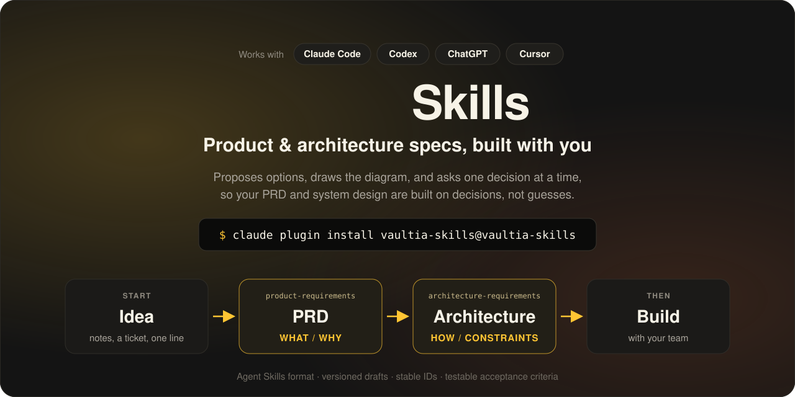

<p align="center">
  <picture>
    <source media="(prefers-color-scheme: dark)" srcset="../../../assets/vaultia-brand-kit/logos/vaultia-horizontal-dark.svg">
    
  </picture>
</p>

<p align="center">
  <a href="../../../README.md">🇺🇸 English</a> | <strong>🇻🇳 Tiếng Việt</strong>
</p>

<p align="center">
  <a href="https://github.com/vaultia-app/vaultia-skills/releases/latest"></a>
  <a href="../../../skills"></a>
  <a href="#cài-đặt"></a>
  
  
</p>

<p align="center">
  <a href="https://github.com/vaultia-app/vaultia-skills/actions/workflows/validate.yml"></a>
  <a href="https://github.com/vaultia-app/vaultia-skills/stargazers"></a>
  <a href="https://github.com/vaultia-app/vaultia-skills/commits/main"></a>
</p>

<p align="center">
  Bộ Agent Skill biến ý tưởng sản phẩm thành tài liệu sẵn sàng để làm: PRD trước, rồi thiết kế hệ thống.<br>Skill làm việc <strong>cùng</strong> bạn: đề xuất phương án và hỏi từng quyết định một thay vì đoán.
</p>

<p align="center">
  
</p>

## Danh sách skill

| Skill | Làm gì | Trả lời câu hỏi |
|---|---|---|
| [`product-requirements`](../../../skills/product-requirements/SKILL.md) | Tài liệu yêu cầu sản phẩm (PRD): mục tiêu, người dùng, hành trình, yêu cầu chức năng, tiêu chí chấp nhận, chỉ số thành công, phạm vi, kế hoạch phát hành | **CÁI GÌ / TẠI SAO** |
| [`architecture-requirements`](../../../skills/architecture-requirements/SKILL.md) | Kiến trúc và thiết kế hệ thống: yếu tố dẫn dắt, thành phần, API, mô hình dữ liệu, NFR, bảo mật, triển khai, ADR | **NHƯ THẾ NÀO / RÀNG BUỘC** |

Mỗi skill cũng dùng riêng được khi đầu vào đã đủ thông tin.

## Cài đặt

### Claude Code

```bash
claude plugin marketplace add vaultia-app/vaultia-skills
claude plugin install vaultia-skills@vaultia-skills        # tất cả skill
claude plugin install product-requirements@vaultia-skills  # hoặc một skill
```

### Codex CLI và ChatGPT

```bash
codex plugin marketplace add vaultia-app/vaultia-skills
codex plugin add vaultia-skills@vaultia-skills
```

Ứng dụng ChatGPT trên máy tính sẽ hiện marketplace đã thêm theo cách này trong mục **Plugins**.

### claude.ai hoặc ChatGPT (upload)

Tải file zip từ [bản release mới nhất](https://github.com/vaultia-app/vaultia-skills/releases/latest), hoặc tự build bằng `python3 scripts/build_plugins.py --zip`.

| Nền tảng | File upload | Ở đâu |
|---|---|---|
| claude.ai | `product-requirements.zip`, `architecture-requirements.zip` (trong `dist/skills/`) | **Settings → Capabilities → Skills** |
| ChatGPT | `vaultia.zip` (trong `dist/plugins/`) | **Plugins → Upload** |

### Copy thủ công (mọi agent)

Copy hoặc tạo symlink thư mục skill vào thư mục skill của agent:

| Nền tảng | Theo project | Theo user |
|---|---|---|
| Claude Code | `.claude/skills/` | `~/.claude/skills/` |
| Codex | `.agents/skills/` | `~/.agents/skills/` |
| Cursor | `.cursor/skills/` | `~/.cursor/skills/` |

```bash
# Claude Code, dùng được ở mọi project
mkdir -p ~/.claude/skills
cp -R skills/product-requirements skills/architecture-requirements ~/.claude/skills/

# Phát triển local: symlink để sửa là thấy ngay
ln -s "$PWD/skills/product-requirements" ~/.claude/skills/product-requirements
```

Thêm lựa chọn, cài cho cả team và cách cập nhật: [plugin-distribution.md](plugin-distribution.md).

## Cách dùng

Cứ hỏi agent bằng ngôn ngữ tự nhiên, tiếng Việt cũng được:

- *"Viết PRD cho app quản lý chi tiêu cá nhân."*
- *"Chuyển biên bản họp này thành yêu cầu kèm tiêu chí chấp nhận."*
- *"Từ PRD này làm thiết kế kỹ thuật."*
- *"Review kiến trúc này xem còn thiếu gì và có rủi ro gì."*

Trong Claude Code bạn cũng có thể gọi trực tiếp, ví dụ `/product-requirements`. Muốn bỏ qua phần hỏi đáp để có bản nháp ngay thì nói *"viết luôn"*.

## Phát triển

Cần Python 3.10+, không có thư viện ngoài.

```bash
python3 scripts/validate.py              # kiểm tra tất cả skill
python3 scripts/build_plugins.py         # sinh lại plugin sau khi sửa skills/
python3 -m unittest discover -s tests    # chạy test
```

Đọc [CONTRIBUTING.md](../../../CONTRIBUTING.md) và [skill-authoring.md](skill-authoring.md) trước khi thêm hoặc sửa skill.

## Lộ trình

- [x] `product-requirements` và `architecture-requirements`, validator, test, CI
- [x] Plugin cho Claude Code và Codex / ChatGPT, marketplace, file zip để upload
- [ ] Trình cài đặt cho kiểu copy thủ công (global / project, dry-run, gỡ cài đặt)
- [ ] Plugin cho Cursor
- [ ] Thêm skill: `product-discovery`, `user-experience-design`, `api-design`, `database-design`, `software-testing`, `software-deployment`

## Giấy phép

Chưa chọn. Giấy phép sẽ được thêm trước bản phát hành công khai đầu tiên.
