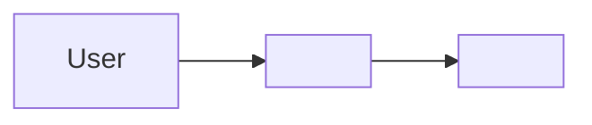
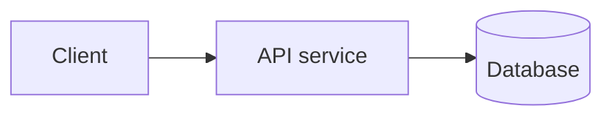
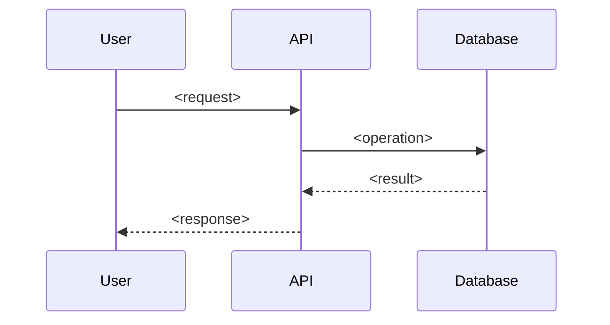

# Architecture Requirements Template

Copy this structure. Omit sections that do not apply; do not reorder. Replace every `<placeholder>`. For small features, sections 1, 3, 5, 7, 9, 12, and 13 are usually enough.

---

```markdown
# <System or Feature Name> — Architecture Requirements

| Field | Value |
|---|---|
| Status | Draft / In review / Approved |
| Version | <v0.1 while iterating; v1.0 when approved> |
| Owner | <name or role> |
| Last updated | <YYYY-MM-DD> |
| Product requirements | <link to PRD> |
| Related | <ADRs, diagrams, tickets> |

## 1. Summary

<Three to five sentences: what is being built, the chosen approach, and the most important trade-off.>

## 2. Context and scope

- **Problem / goals:** <Short restatement, linked to the PRD.>
- **In scope:** <Components, flows, integrations covered by this document.>
- **Out of scope:** <What this design does not address.>
- **Existing system:** <Relevant current architecture, stack, and conventions.>

## 3. Architectural drivers

### Key functional requirements
| ID | Requirement (from PRD) | Architectural impact |
|---|---|---|
| FR-1 | <requirement> | <why it shapes the design> |

### Quality attributes
| ID | Attribute | Target | Source |
|---|---|---|---|
| NFR-1 | <Performance / Availability / ...> | <measurable target> | <PRD ID, stakeholder, or "assumption"> |

### Constraints
- C-1: <technology, regulatory, organizational, budget, or time constraint>

## 4. System context

<Who and what interacts with the system: users, external systems, third-party services.>



## 5. Solution overview

<Architectural style and the main building blocks. Explain how the design satisfies the drivers.>



## 6. Components

| Component | Responsibility | Technology | Owns data | Depends on |
|---|---|---|---|---|
| <name> | <single clear responsibility> | <language/framework/runtime> | <entities> | <components/services> |

## 7. Key flows

### Flow 1: <name> (FR-1)

<Notes on error handling, retries, idempotency, and timeouts for this flow.>

## 8. Interfaces and APIs

<Summary table plus links to detailed specs (OpenAPI, protobuf, GraphQL schema). See api-design reference.>

| Operation | Method / channel | Purpose | Auth | Notes |
|---|---|---|---|---|
| <name> | <GET /v1/...> | <purpose> | <scheme> | <idempotency, pagination, limits> |

## 9. Data model

<Entities, relationships, storage choice, ownership, retention. See data-model reference.>

| Entity | Key fields | Store | Owner | Retention | Sensitivity |
|---|---|---|---|---|---|
| <Entity> | <id, ...> | <database/table> | <component> | <period> | Public / Internal / Confidential / Restricted |

## 10. Non-functional design

| NFR | Target | Design response | Verification |
|---|---|---|---|
| NFR-1 | <p95 < 300 ms> | <caching, indexing, async processing> | <load test, monitoring> |

Cover where relevant: performance, scalability, availability, resilience, observability, security, privacy, cost, maintainability.

## 11. Security and compliance

- **Authentication / authorization:** <approach>
- **Data protection:** <encryption in transit / at rest, key management>
- **Threats and controls:** <top threats and mitigations>
- **Compliance:** <applicable regulations and how they are met>

## 12. Deployment and operations

- **Environments:** <dev / staging / production>
- **Infrastructure:** <hosting, regions, scaling model>
- **Release strategy:** <CI/CD, feature flags, canary, migrations>
- **Observability:** <logs, metrics, traces, alerts, dashboards>
- **Backup and recovery:** <RPO / RTO, restore procedure>
- **Rollback:** <how to revert safely>

## 13. Architecture decisions

### ADR-1: <Decision title>
- **Status:** Proposed / Accepted / Superseded by ADR-n
- **Context:** <forces and drivers>
- **Options considered:** <option A, option B, ...>
- **Decision:** <what was chosen>
- **Consequences:** <benefits, costs, risks, follow-ups>

## 14. Risks and technical debt

| Risk | Likelihood | Impact | Mitigation |
|---|---|---|---|
| <risk> | Low / Med / High | Low / Med / High | <mitigation> |

## 15. Decisions, assumptions, and open questions

### Confirmed decisions
- D-1: <decision> — <who / when>

### Assumptions
- A-1: <assumption> — <how to validate>

### Open questions
- Q-1: <question> — <owner, needed by>

## 16. Requirements traceability

| PRD ID | Addressed by (component / flow / ADR) | Status |
|---|---|---|
| FR-1 | <component, flow 1> | Covered / Partial / Not covered |

## Change log

| Version | Decisions applied | Sections changed |
|---|---|---|
| v0.1 | <initial proposal> | All |
```
