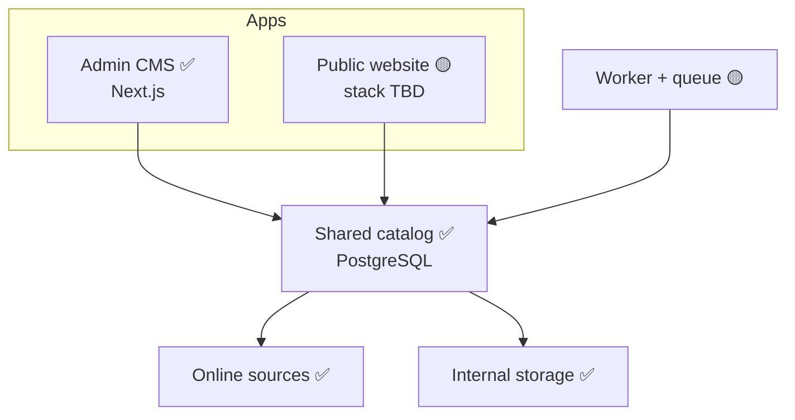

# Collaborative Loop (Guided Mode)

Work like a senior architect at a whiteboard with the user: **propose, visualize, draft, ask for one decision, update** — and repeat until the design is agreed. The user should always see a concrete, versioned proposal they can react to, never a list of questions and never a "final" design built on guessed drivers.

## The loop

```text
Propose → Visualize → Draft vN → Decide one thing → Update to vN+1 → …
```

Every guided turn uses this shape (skip a part only when it adds nothing):

1. **Understanding + key insight.** Two to four sentences restating the goal and context, then one **bold, opinionated insight** — the most important structural recommendation (for example, "do not keep the current `orders` table as the center of everything; introduce a separate catalog layer"). Lead with a point of view, not a question.
2. **Architecture diagram.** One diagram of the proposed structure (see *Diagrams*). On later turns, update the same diagram and mark what is now decided.
3. **Structure table.** Components, table groups, or services in a table: group → elements → responsibility. Call out one subtle modeling distinction the user is likely to miss (for example "a product is not a release, and a release is not a file").
4. **Draft vN.** Create or update the design document and say what changed (see *Versioned drafts*).
5. **Evolution path (when useful).** Phases 1 → n, each with a one-line reason for its position, so the design stays extensible without being built all at once.
6. **One blocking decision.** End with the single decision that must be settled before going deeper (for example "before writing the SQL schema"). See *Asking for a decision*. Ask at most three only if they are independent and all blocking.

When the user answers — even loosely, mixing stack choices, scope, and new requirements — start the next turn with "Updated based on your decisions:", fold **every** stated decision into the diagram, tables, and draft, add a comparison table when a decision introduces a new distinction, then raise the next most important issue.

**Keep the loop moving until v1.0.** Every turn ends with a decision for the user to answer — never with only a list of remaining questions, a "reply 'yes' if correct" sentence, or a summary.

- **Progress line.** After the draft update, show one line against the agenda (see *Decision agenda and when to stop*), such as `Agenda: 4/9 decided · next: <topic> · then: <topic>, <topic>`, so the user sees how far v1.0 is.
- **Confirming a typed answer.** When you had to interpret a typed answer, do not ask for confirmation in prose. Put the confirmation in the same choice form as the next decision: one question "I understood <X> — correct?" with options *Correct (recommended)* / *<the most likely alternative>*, plus the next blocking decision as a second question.
- **Open questions are the queue.** Each `Q-n` in the draft's open-questions list is asked in a later turn, highest impact first, until every question that changes scope, requirements, or metrics is ✅ or explicitly deferred by the user. Questions that change nothing are moved to *Open questions (non-blocking)* instead of being asked.
- **Closing.** When the blocking queue is empty, ask a final choice: *Finalize v1.0 (recommended)* / *Review section by section first*. Do not stop at a v0.x draft without offering this.

## Starting point

Classify the input first:

- **Vague input** — essentials are missing (for example "build an app for my business", or one line without users or purpose). Start with the **intake** below.
- **Partial input** — some essentials are answered. Run the intake only for the missing items.
- **Rich input** (notes, existing docs, tickets, a codebase, a handoff): skip the intake, follow `existing-context.md` when decisions already exist, and create Draft v0.1 in the first turn, marking every proposal not backed by the input as 🟡.
- **Fast mode requested** ("just write it", "viết luôn"): skip the loop, draft the full document, and list every unconfirmed item as an assumption.

### Intake (vague or partial input)

Turn 1 is a short intake form — not a draft, not directions yet. One sentence restating what you understood, then the missing items from this list (at most 7) through the choice tool:

| Item | Ask |
|---|---|
| System / feature name | Free text |
| Requirements source | Approved PRD, draft PRD, idea only |
| Expected scale | Users, records, requests, or file volume in 12 months — ranges as options |
| Existing stack and hosting | Greenfield, or name the current stack / cloud — common options |
| Team | Size and strengths (for example "2 full-stack TypeScript devs") |
| Integrations | Multi-select of typical external systems in this domain |
| Hard constraints | Budget, data residency, compliance, deadline — multi-select plus "none yet" |

Rules:
- **Every item has suggested answers** drawn from your knowledge of the domain, recommended one first, so the user can click instead of writing. Only the name is free text. Mark multi-select items as such.
- **Every item can be skipped**: say in the intro that the user can leave anything for you to decide; skipped items become 🟡 assumptions.
- **Do not ask what the input already answers.** Show those as "Understood: …" in the intro.
- **Fit the host's limits**: ChatGPT / Codex `request_user_input_async` takes all items in one call (omit `options` for free text); Claude `AskUserQuestion` takes 4 questions per call — ask the 4 most important, then the rest in the next turn; plain text — a numbered list the user can answer in one message.

### After the intake: enrich with domain knowledge

When the answers arrive, before drafting:

1. **Restate** the project in 3–5 lines from the answers.
2. **Domain notes** — what an expert in this domain would add: reference architectures for this kind of system, data and consistency pitfalls, security and compliance obligations, typical integrations and their failure modes, and cost drivers. Mark each as 🟡 proposal. Facts that change over time (laws, tax and price rules, platform policies) need a source and date, or the label "verify" when you cannot check them.
3. If the answers still allow very different designs, propose 2–3 candidate architectures with the key trade-off of each and a diagram for the recommended one, and ask which to pursue; otherwise go straight to Draft v0.1.
4. Publish the stages and the decision agenda (see *Decision agenda and when to stop*), then ask the first decision.

## Which decision to ask next

Ask the decision whose answer would change the most of the design. Typical order, adjusted to what is already known:

1. Who and what the system serves (internal tool, public product, both; tenants)
2. System boundary and integrations (sources, external services, what is in/out)
3. Core domain model — the central entities and their relationships
4. Data and storage ownership (sources of truth, where files/data live, consistency needs)
5. Quality drivers with numbers (scale, latency, availability, data sensitivity)
6. Stack and deployment constraints (existing stack, hosting, team skills)

Challenge risky choices while doing this: an unnecessary new data store, a missing source of truth, or an unmeasurable NFR deserves a sharper counter-proposal with the driver named.

## Decision agenda and when to stop

The loop must have a visible end. Plan it, keep it short, and close it.

**0. Stages with approval gates.** Build the document in stages — Drivers & context → Architecture style & components → Data model (logical → physical) → Interfaces, security & NFRs → Deployment, migration & milestones — and show them as a checklist with status (✅ approved · 🔄 in progress · ⏳ not started). A stage closes only when the user approves it; ask for that approval through the choice tool (*Approve <stage> (recommended)* / *Needs changes*), bundled with the first decision of the next stage. Approved stages are not reopened unless the user asks or a later answer changes them (then use *Answers to an already-decided question*).

**Documentation sets.** If the user asks for a whole set of documents ("build the docs for my app"), first show a short document map — each document, what it covers, which skill produces it, and the order (product requirements first, then architecture) — and confirm it before starting the first one. Do not draft documents another skill owns.

**1. Publish the agenda first.** On the first guided turn, list the decisions that must be made before v1.0 — usually **8–12** — as a numbered checklist (`D-1 … D-n`, one line each, recommended answer in brackets when you already have one). This is the scope of the conversation. Show it again, with ✅ / 🟡 / ⏳ marks, whenever it changes.

**2. Ask only one-way-door decisions.** A question earns a place on the agenda only if the answer is hard to reverse later or changes the structure of the document, for example: system boundary and tenancy, architecture style (monolith / services / serverless), core domain model and sources of truth, primary data store, hosting and runtime platform, authentication and authorization model, sync vs. async processing for core flows, integration contracts with external systems.

**3. Decide the rest yourself as defaults.** Two-way-door and implementation-level details — for example storage key or file naming scheme, image sizes and formats, library choices inside an already chosen stack, retry counts and timeouts, log fields, folder structure, naming conventions, exact limits and thresholds that can be tuned later — are not asked one by one. Choose a sensible default, record it as 🟡 in a *Defaults (review anytime)* table in the draft (item, default, one-line reason), and mention new defaults in one line per turn. The user can override any default by replying; that does not reopen the loop.

**4. Batch to move faster.** Ask up to 3 independent agenda items in one choice-tool call. Never ask the same topic twice unless the user reopens it.

**5. New agenda items need a reason.** Add a decision to the agenda only when an answer or a user idea creates a new one-way door; say why it was added and show the new total (`Agenda: 6/9 decided · +1 added: <topic> because <reason>`).

**6. Stop rules.**
- Close the loop when every agenda item is ✅ or explicitly deferred, and boundary, core domain model, sources of truth, key quality drivers with numbers, and stack constraints are confirmed. Remaining unknowns that do not block implementation go to *Open questions (non-blocking)*.
- If the asked decisions reach about **12** and items remain, stop adding: offer *Finalize v1.0 with the remaining items as 🟡 defaults (recommended)* / *Continue with the remaining <n> decisions* / *Review the defaults table first*.

**7. Keep the conversation light.** The draft file is the memory, not the chat: show only what changed, the progress line, and the diagram when it changed. If the conversation is getting long, suggest continuing in a new chat that starts from the latest draft file and its decision log, so nothing is lost.

## Asking for a decision

Every decision is asked through the host's **choice tool** when one is available — on **every** turn of the loop, not only the first. Plain-text A/B/C lists are only the fallback for hosts without such a tool. After calling the tool, **end your turn and wait**: do not continue drafting content that depends on the answer.

### Host choice tools

| Host | Tool | How to fill it |
|---|---|---|
| ChatGPT, Codex | `request_user_input_async` | `questions: [{"title": "<full question with the context needed>", "options": ["<recommended> (recommended)", "<option>", "<option>"]}]` — options are plain strings |
| Codex Plan mode | `request_user_input` | 1–3 questions, each `{"id": "snake_case", "header": "≤12 chars", "options": [{"label": "1–5 words (Recommended)", "description": "one-sentence trade-off"}, …]}` with 2–3 options |
| Claude (Claude Code, Desktop, claude.ai) | `AskUserQuestion` or the host's equivalent | 1–4 questions, each with a short `header`, 2–4 options with `label` + `description`, and `multiSelect` (true when several answers are allowed); add "(Recommended)" to the first option's label |
| Self-built forms (inline widgets, visualizations, HTML cards) | the form you render | same rules below, **plus** an "Other — type your own answer" option with a text input |

Rules for every choice tool:

- **Give every decision a stable ID** (`D-1`, `D-2`, …) and put it at the start of the question title (for example "D-3 · Primary user: …"). Use the same ID in the draft's decision log, so any answer can be traced to its question.
- **Recommended option first**, with "(recommended)" in its label in the user's language. Several hosts preselect the first option.
- **"Other" depends on what renders the form:**
  - **Native question tools** listed above (`request_user_input_async`, `request_user_input`, `AskUserQuestion`): do **not** add an "Other" option — they add free-text input automatically.
  - **Any form you build yourself** — an inline widget, visualization, HTML/React card, or custom form with radio buttons and a submit button: you **must** add a last option **"Other — type your own answer"** with a text input that is submitted as the answer. These forms have no built-in free text; without it the user can only pick your options.
  - If unsure which one you are using, add the "Other" option with a text input.
- **Short labels, consequences in descriptions** (or after a dash when options are plain strings). 2–4 mutually exclusive options in the user's domain terms.
- **The title is self-contained**: the user may see only the form, so include the context needed to answer.
- **Up to 3 questions in one call** when they are independent (for example, confirming an interpreted answer plus the next decision). Otherwise one.
- **Multiple-choice questions** (the user may pick several, for example which features go into the MVP, which platforms, which user roles):
  - Claude `AskUserQuestion`: set `multiSelect: true`.
  - Any other tool with a multi-select flag: use it.
  - ChatGPT / Codex (single-select plus free text): say in the title that several can be chosen and how to type them (for example "Choose one set, or type your own combination such as \"A, C, D\""). Offer ready-made sets as options, recommended set first — for example "Core set (recommended): A + B + D", "All of them", "Only A". Do not split one multi-select question into many yes/no questions.
  - Plain-text fallback: label the items A, B, C… and end with "Reply with one or more letters (for example \"A, C\"), your own answer, or \"you decide\"".
  - Record every selected item as its own decision in the draft (for example each chosen feature as Must), and the unselected ones as Later / out of scope.
- **Never put instructions in options or titles** such as "update the PRD and ask the next question". The selection the user submits should read as their answer only.

### Fallback: plain text

Only when the host has no choice tool:

```text
### Decision needed before <next step>

<Question?>

A) <Option> — <what it implies for the design> ← recommended: <one-line reason>
B) <Option> — <what it implies for the design>
C) <Option> — <what it implies for the design>

Reply with a letter, your own answer, or "you decide".
```

### Handling answers

- Options are concrete and mutually exclusive; the consequence of each is visible so the user decides on trade-offs, not labels.
- "You decide" → take the recommendation and record it as 🟡 assumption, and as a proposed ADR if significant.
- A typed answer takes priority over a selected option. If it is unclear or contradicts the options, record your interpretation as 🟡 and confirm it through the choice tool on the next turn (see *Keep the loop moving until v1.0*); mark it ✅ only after the user agrees.
- **Answers to an already-decided question.** Hosts keep old forms clickable, so the user may scroll up and pick a different option for an earlier `D-n`. Never overwrite silently:
  1. Say which decision it changes ("This changes D-2 · Primary user from *Individual gamers* to *Collectors*").
  2. List what depends on it: later decisions, requirements, metrics, and diagram nodes that would change or become invalid.
  3. Ask through the choice tool: *Keep <current value> (recommended unless the user clearly meant to change it)* / *Change to <new value> and update the affected parts*.
  4. On *Change*: bump the draft version, update every affected part, mark dependent decisions 🟡 for re-confirmation, and record the old and new value in the change log. On *Keep*: change nothing and continue with the pending question.
  - If a pending question is still open, answer handling for it comes first; then raise the change.

### New ideas and side discussions

The user may bring up something outside the pending question — a feature they just remembered, a constraint, a change of mind — and discuss it freely in chat. Never let it stay only in the conversation:

1. Discuss it as long as the user wants; give your opinion and any trade-off they should know.
2. When the discussion reaches a conclusion (or the user moves on), end the turn with a **short summary** of what was agreed — what it is, who it is for, and why — then ask through the choice tool how to capture it. Give it a new ID (`D-n`, or `FR-n` for a requirement) and options such as:
   - *Add to the draft as <Must / MVP> (recommended when it serves the primary journey)*
   - *Add as <Should / Later phase>*
   - *Record as an open question to decide later*
   - *Don't add it*
3. On an *Add* answer: update the draft, diagram, and scope table, bump the version, and log it in the change log. If it conflicts with or changes an earlier decision, handle it like *Answers to an already-decided question* (show impact, ask keep or change).
4. If a decision was pending before the side discussion, ask it again in the **same** choice tool call as the capture question, so the loop continues.

## Diagrams

Write diagrams as Mermaid in fenced code blocks tagged `mermaid` — that is the portable source kept in the document file (GitHub, IDEs, Claude, most Markdown viewers render it). Keep each diagram to roughly 12 nodes or fewer — split rather than cram.

**Make sure the user actually sees a diagram, not code.** Some surfaces show Mermaid as plain text — notably ChatGPT's chat, canvas, and document views. There:

1. Keep the ```` ```mermaid ```` block in the saved document, unchanged.
2. In the chat, **also render the diagram visually** with the host's own tool (inline visualization, image, or diagram tool) so the user sees boxes and lines.
3. If no visual tool is available, show a readable fallback instead of raw Mermaid: for an ER diagram, a relationship table (`Entity | Relationship | Entity | Cardinality`, for example `Branch | manages | Vehicle | 1 : N`); for flows, a short numbered list or an indented text tree.
4. Never leave unrendered Mermaid as the only view in chat. If the user says a diagram "is broken" or shows as code, switch to steps 2–3 for the rest of the conversation.

Write Mermaid that renders: one relationship per line, entity names in `UPPER_SNAKE` or `PascalCase` without spaces, labels with spaces in quotes (`ROOM ||--o{ CONTRACT : "rented under"`), and no attributes or types in conceptual ER diagrams.

Pick by purpose:

| Purpose | Diagram |
|---|---|
| Layers and data flow (sources → processing → core → consumers) | `flowchart TD` with `subgraph` per layer |
| System context and integrations | `flowchart LR`: users/clients → system → external systems |
| Data model | `erDiagram` with only the key entities and relationships |
| A key request or job flow | `sequenceDiagram` |
| Lifecycle of a key entity (job, file, link) | `stateDiagram-v2` |

Mark decision status on nodes so the diagram doubles as a decision map:



- ✅ confirmed by the user · 🟡 proposed or assumed · `TBD` unknown — never fill an unknown technology, number, or vendor with an invented one.
- When a diagram becomes fully confirmed, title it "Agreed architecture" so the user sees progress.

## Versioned drafts

- Save to the design file from the start (default `docs/05-architecture/<system-or-feature>.md` in the standard `docs/` structure, otherwise `docs/architecture/<system-or-feature>.md`; inline if there is no project). Update the same file each turn.
- Bump the version in the header on every substantive update: v0.1, v0.2, … Reserve v1.0 for the version the user approves.
- Keep a **Change log** at the end: version → decisions applied → sections changed. Significant decisions also become ADRs.
- In chat, show only what changed plus the updated diagram — not the whole document.

## Clarification notes

When a term or boundary could be misread, add a short **Architecture note:** that pins it down (for example, "Google Drive is on the internet but counts as internal storage here because we control where files live; `localhost` means the worker/server machine, not the visitor's machine"). These notes prevent most rework.

## Finishing

Move to the full template, security, and validation pass when the core is ✅: boundary, core domain model, sources of truth, key quality drivers with numbers, and stack constraints. Then complete the remaining sections, ask the user to approve v1.0, and summarize trade-offs, risks, and open questions.
