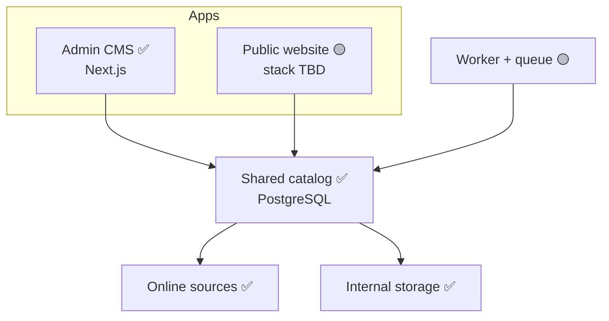

# Collaborative Loop (Guided Mode)

Work like a senior architect at a whiteboard with the user: **propose, visualize, draft, ask for one decision, update** — and repeat until the design is agreed. The user should always see a concrete, versioned proposal they can react to, never a list of questions and never a "final" design built on guessed drivers.

## The loop

```text
Propose → Visualize → Draft vN → Decide one thing → Update to vN+1 → …
```

Every guided turn uses this shape (skip a part only when it adds nothing):

1. **Understanding + key insight.** Two to four sentences restating the goal and context, then one **bold, opinionated insight** — the most important structural recommendation (for example, "do not keep the current `orders` table as the center of everything; introduce a separate catalog layer"). Lead with a point of view, not a question.
2. **Architecture diagram.** One diagram of the proposed structure (see *Diagrams*). On later turns, update the same diagram and mark what is now decided.
3. **Structure table.** Components, table groups, or services in a table: group → elements → responsibility. Call out one subtle modeling distinction the user is likely to miss (for example "a product is not a release, and a release is not a file").
4. **Draft vN.** Create or update the design document and say what changed (see *Versioned drafts*).
5. **Evolution path (when useful).** Phases 1 → n, each with a one-line reason for its position, so the design stays extensible without being built all at once.
6. **One blocking decision.** End with the single decision that must be settled before going deeper (for example "before writing the SQL schema"). See *Asking for a decision*. Ask at most three only if they are independent and all blocking.

When the user answers — even loosely, mixing stack choices, scope, and new requirements — start the next turn with "Updated based on your decisions:", fold **every** stated decision into the diagram, tables, and draft, add a comparison table when a decision introduces a new distinction, then raise the next most important issue.

**Keep the loop moving until v1.0.** Every turn ends with a decision for the user to answer — never with only a list of remaining questions, a "reply 'yes' if correct" sentence, or a summary.

- **Progress line.** After the draft update, show one line such as `Progress: 4/7 decided · next: <topic> · then: <topic>, <topic>` so the user sees how far v1.0 is.
- **Confirming a typed answer.** When you had to interpret a typed answer, do not ask for confirmation in prose. Put the confirmation in the same choice form as the next decision: one question "I understood <X> — correct?" with options *Correct (recommended)* / *<the most likely alternative>*, plus the next blocking decision as a second question.
- **Open questions are the queue.** Each `Q-n` in the draft's open-questions list is asked in a later turn, highest impact first, until every question that changes scope, requirements, or metrics is ✅ or explicitly deferred by the user. Questions that change nothing are moved to *Open questions (non-blocking)* instead of being asked.
- **Closing.** When the blocking queue is empty, ask a final choice: *Finalize v1.0 (recommended)* / *Review section by section first*. Do not stop at a v0.x draft without offering this.

## Starting point

- **Rich input** (PRD, existing schema, codebase, handoff notes): inspect it, propose directly, and create Draft v0.1 in the first turn. Proposals not backed by the input are marked 🟡.
- **Thin input** (one-line request): propose 2–3 candidate architectures with a diagram for the recommended one and the key trade-off of each, and ask which to pursue before drafting.
- **Fast mode requested** ("just write it"): skip the loop, draft the full document, and list every unconfirmed driver as an assumption.

## Which decision to ask next

Ask the decision whose answer would change the most of the design. Typical order, adjusted to what is already known:

1. Who and what the system serves (internal tool, public product, both; tenants)
2. System boundary and integrations (sources, external services, what is in/out)
3. Core domain model — the central entities and their relationships
4. Data and storage ownership (sources of truth, where files/data live, consistency needs)
5. Quality drivers with numbers (scale, latency, availability, data sensitivity)
6. Stack and deployment constraints (existing stack, hosting, team skills)

Challenge risky choices while doing this: an unnecessary new data store, a missing source of truth, or an unmeasurable NFR deserves a sharper counter-proposal with the driver named.

## Asking for a decision

Every decision is asked through the host's **choice tool** when one is available — on **every** turn of the loop, not only the first. Plain-text A/B/C lists are only the fallback for hosts without such a tool. After calling the tool, **end your turn and wait**: do not continue drafting content that depends on the answer.

### Host choice tools

| Host | Tool | How to fill it |
|---|---|---|
| ChatGPT, Codex | `request_user_input_async` | `questions: [{"title": "<full question with the context needed>", "options": ["<recommended> (recommended)", "<option>", "<option>"]}]` — options are plain strings |
| Codex Plan mode | `request_user_input` | 1–3 questions, each `{"id": "snake_case", "header": "≤12 chars", "options": [{"label": "1–5 words (Recommended)", "description": "one-sentence trade-off"}, …]}` with 2–3 options |
| Claude (Claude Code, Desktop, claude.ai) | `AskUserQuestion` or the host's equivalent | 1–4 questions, each with a short `header`, 2–4 options with `label` + `description`, and `multiSelect` (true when several answers are allowed); add "(Recommended)" to the first option's label |
| Any other host with a choice form | that tool | same rules below |

Rules for every choice tool:

- **Recommended option first**, with "(recommended)" in its label in the user's language. Several hosts preselect the first option.
- **Do not add an "Other" option or a free-text placeholder.** These tools add free-text input automatically.
- **Short labels, consequences in descriptions** (or after a dash when options are plain strings). 2–4 mutually exclusive options in the user's domain terms.
- **The title is self-contained**: the user may see only the form, so include the context needed to answer.
- **Up to 3 questions in one call** when they are independent (for example, confirming an interpreted answer plus the next decision). Otherwise one.
- **Multiple-choice questions** (the user may pick several, for example which features go into the MVP, which platforms, which user roles):
  - Claude `AskUserQuestion`: set `multiSelect: true`.
  - Any other tool with a multi-select flag: use it.
  - ChatGPT / Codex (single-select plus free text): say in the title that several can be chosen and how to type them (for example "Choose one set, or type your own combination such as \"A, C, D\""). Offer ready-made sets as options, recommended set first — for example "Core set (recommended): A + B + D", "All of them", "Only A". Do not split one multi-select question into many yes/no questions.
  - Plain-text fallback: label the items A, B, C… and end with "Reply with one or more letters (for example \"A, C\"), your own answer, or \"you decide\"".
  - Record every selected item as its own decision in the draft (for example each chosen feature as Must), and the unselected ones as Later / out of scope.
- **Never put instructions in options or titles** such as "update the PRD and ask the next question". The selection the user submits should read as their answer only.

### Fallback: plain text

Only when the host has no choice tool:

```text
### Decision needed before <next step>

<Question?>

A) <Option> — <what it implies for the design> ← recommended: <one-line reason>
B) <Option> — <what it implies for the design>
C) <Option> — <what it implies for the design>

Reply with a letter, your own answer, or "you decide".
```

### Handling answers

- Options are concrete and mutually exclusive; the consequence of each is visible so the user decides on trade-offs, not labels.
- "You decide" → take the recommendation and record it as 🟡 assumption, and as a proposed ADR if significant.
- A typed answer takes priority over a selected option. If it is unclear or contradicts the options, record your interpretation as 🟡 and confirm it through the choice tool on the next turn (see *Keep the loop moving until v1.0*); mark it ✅ only after the user agrees.

## Diagrams

Use Mermaid in fenced code blocks; it renders in most agent UIs, IDEs, and on GitHub. If rendering is unavailable, an indented text diagram is acceptable. Keep each diagram to roughly 12 nodes or fewer — split rather than cram.

Pick by purpose:

| Purpose | Diagram |
|---|---|
| Layers and data flow (sources → processing → core → consumers) | `flowchart TD` with `subgraph` per layer |
| System context and integrations | `flowchart LR`: users/clients → system → external systems |
| Data model | `erDiagram` with only the key entities and relationships |
| A key request or job flow | `sequenceDiagram` |
| Lifecycle of a key entity (job, file, link) | `stateDiagram-v2` |

Mark decision status on nodes so the diagram doubles as a decision map:



- ✅ confirmed by the user · 🟡 proposed or assumed · `TBD` unknown — never fill an unknown technology, number, or vendor with an invented one.
- When a diagram becomes fully confirmed, title it "Agreed architecture" so the user sees progress.

## Versioned drafts

- Save to the design file from the start (default `docs/architecture/<system-or-feature>.md`; inline if there is no project). Update the same file each turn.
- Bump the version in the header on every substantive update: v0.1, v0.2, … Reserve v1.0 for the version the user approves.
- Keep a **Change log** at the end: version → decisions applied → sections changed. Significant decisions also become ADRs.
- In chat, show only what changed plus the updated diagram — not the whole document.

## Clarification notes

When a term or boundary could be misread, add a short **Architecture note:** that pins it down (for example, "Google Drive is on the internet but counts as internal storage here because we control where files live; `localhost` means the worker/server machine, not the visitor's machine"). These notes prevent most rework.

## Finishing

Move to the full template, security, and validation pass when the core is ✅: boundary, core domain model, sources of truth, key quality drivers with numbers, and stack constraints. Then complete the remaining sections, ask the user to approve v1.0, and summarize trade-offs, risks, and open questions.
