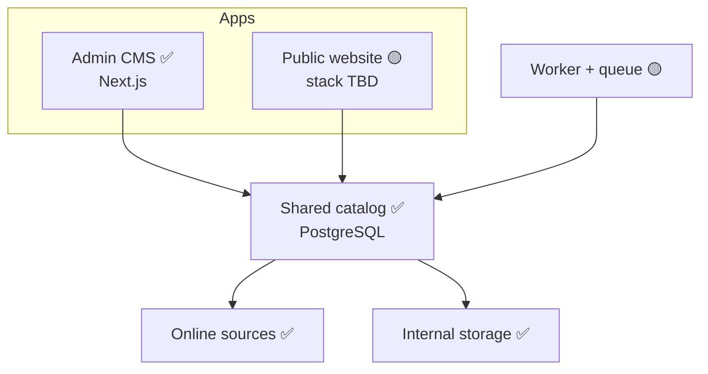

# Collaborative Loop (Guided Mode)

Work like a senior architect at a whiteboard with the user: **propose, visualize, draft, ask for one decision, update** — and repeat until the design is agreed. The user should always see a concrete, versioned proposal they can react to, never a list of questions and never a "final" design built on guessed drivers.

## The loop

```text
Propose → Visualize → Draft vN → Decide one thing → Update to vN+1 → …
```

Every guided turn uses this shape (skip a part only when it adds nothing):

1. **Understanding + key insight.** Two to four sentences restating the goal and context, then one **bold, opinionated insight** — the most important structural recommendation (for example, "do not keep the current `orders` table as the center of everything; introduce a separate catalog layer"). Lead with a point of view, not a question.
2. **Architecture diagram.** One diagram of the proposed structure (see *Diagrams*). On later turns, update the same diagram and mark what is now decided.
3. **Structure table.** Components, table groups, or services in a table: group → elements → responsibility. Call out one subtle modeling distinction the user is likely to miss (for example "a product is not a release, and a release is not a file").
4. **Draft vN.** Create or update the design document and say what changed (see *Versioned drafts*).
5. **Evolution path (when useful).** Phases 1 → n, each with a one-line reason for its position, so the design stays extensible without being built all at once.
6. **One blocking decision.** End with the single decision that must be settled before going deeper (for example "before writing the SQL schema"). See *Asking for a decision*. Ask at most three only if they are independent and all blocking.

When the user answers — even loosely, mixing stack choices, scope, and new requirements — start the next turn with "Updated based on your decisions:", fold **every** stated decision into the diagram, tables, and draft, add a comparison table when a decision introduces a new distinction, then raise the next most important issue.

## Starting point

- **Rich input** (PRD, existing schema, codebase, handoff notes): inspect it, propose directly, and create Draft v0.1 in the first turn. Proposals not backed by the input are marked 🟡.
- **Thin input** (one-line request): propose 2–3 candidate architectures with a diagram for the recommended one and the key trade-off of each, and ask which to pursue before drafting.
- **Fast mode requested** ("just write it"): skip the loop, draft the full document, and list every unconfirmed driver as an assumption.

## Which decision to ask next

Ask the decision whose answer would change the most of the design. Typical order, adjusted to what is already known:

1. Who and what the system serves (internal tool, public product, both; tenants)
2. System boundary and integrations (sources, external services, what is in/out)
3. Core domain model — the central entities and their relationships
4. Data and storage ownership (sources of truth, where files/data live, consistency needs)
5. Quality drivers with numbers (scale, latency, availability, data sensitivity)
6. Stack and deployment constraints (existing stack, hosting, team skills)

Challenge risky choices while doing this: an unnecessary new data store, a missing source of truth, or an unmeasurable NFR deserves a sharper counter-proposal with the driver named.

## Asking for a decision

If the platform offers a structured question or choice tool (a selectable form), use it for **every** decision, on **every** turn of the loop — not only the first one. Never fall back to plain-text A/B/C options while the tool is available, even after the user has answered previous questions in chat or by typing. Always include a free-text "Other" option (see below). If the platform has no such tool, use this format:

```text
### Decision needed before <next step>

<Question?>

A) <Option> — <what it implies for the design>
B) <Option> — <what it implies for the design>
C) <Option> — <what it implies for the design> ← recommended: <one-line reason>

Reply with a letter, your own answer, or "you decide".
```

- Options are concrete and mutually exclusive; each shows its design consequence.
- "You decide" → take the recommendation and record it as 🟡 assumption, and as a proposed ADR if significant.

**Always let the user type their own answer.** Every question must accept a free-text answer in addition to the listed options:

- **Choice tool / form** (radio buttons, option chips): add a last option **"Other — type your own answer"** with a text input. If the tool cannot attach a text field to an option, add a separate optional free-text field ("Your own answer") under the options, or state right below the form that the user can type any answer in chat instead.
- **Plain text:** keep the closing line "Reply with a letter, your own answer, or \"you decide\"".
- Mark the recommended option in the form label too (for example "B. Several properties (recommended)"), not only in the text above it.
- A typed answer takes priority over a selected option. If it is unclear or contradicts the options, restate how you understood it and record it as ✅ confirmed only after the user agrees.

## Diagrams

Use Mermaid in fenced code blocks; it renders in most agent UIs, IDEs, and on GitHub. If rendering is unavailable, an indented text diagram is acceptable. Keep each diagram to roughly 12 nodes or fewer — split rather than cram.

Pick by purpose:

| Purpose | Diagram |
|---|---|
| Layers and data flow (sources → processing → core → consumers) | `flowchart TD` with `subgraph` per layer |
| System context and integrations | `flowchart LR`: users/clients → system → external systems |
| Data model | `erDiagram` with only the key entities and relationships |
| A key request or job flow | `sequenceDiagram` |
| Lifecycle of a key entity (job, file, link) | `stateDiagram-v2` |

Mark decision status on nodes so the diagram doubles as a decision map:



- ✅ confirmed by the user · 🟡 proposed or assumed · `TBD` unknown — never fill an unknown technology, number, or vendor with an invented one.
- When a diagram becomes fully confirmed, title it "Agreed architecture" so the user sees progress.

## Versioned drafts

- Save to the design file from the start (default `docs/architecture/<system-or-feature>.md`; inline if there is no project). Update the same file each turn.
- Bump the version in the header on every substantive update: v0.1, v0.2, … Reserve v1.0 for the version the user approves.
- Keep a **Change log** at the end: version → decisions applied → sections changed. Significant decisions also become ADRs.
- In chat, show only what changed plus the updated diagram — not the whole document.

## Clarification notes

When a term or boundary could be misread, add a short **Architecture note:** that pins it down (for example, "Google Drive is on the internet but counts as internal storage here because we control where files live; `localhost` means the worker/server machine, not the visitor's machine"). These notes prevent most rework.

## Finishing

Move to the full template, security, and validation pass when the core is ✅: boundary, core domain model, sources of truth, key quality drivers with numbers, and stack constraints. Then complete the remaining sections, ask the user to approve v1.0, and summarize trade-offs, risks, and open questions.
