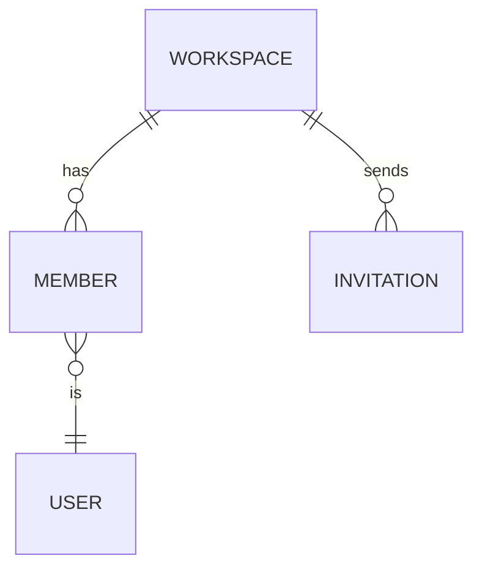

# Data Model Guidelines

Describe what data exists, who owns it, where it lives, how it changes, and how long it is kept. In an existing codebase, read the current schema and migrations first and extend them consistently.

**Start from what is already decided.** If a PRD has a domain model (objects, relationships, `BR-n` rules; in the standard `docs/` structure: `docs/01-business/02-domain-model.md` and `03-business-rules.md`), treat it as the conceptual model and do not re-ask it: refine it into a logical model (attributes, types, keys) and then a physical one (tables, constraints, indexes, store). If tables already exist, **extend them with new columns or relations instead of creating parallel tables**, and keep their names; propose any rename or split explicitly as a change (see `existing-context.md`).

## Entity specification

For each entity, record:

| Field | Description |
|---|---|
| Name | Singular, domain language (`Invoice`, `Member`) |
| Purpose | Why it exists; which requirements use it |
| Key attributes | Identifier, important fields, types, required/optional, constraints |
| Relationships | Cardinality (1:1, 1:N, N:M) and ownership |
| Owner | The single component/service allowed to write it |
| Store | Database / table / collection / bucket |
| Lifecycle | States and transitions (e.g. `draft → sent → paid → void`) |
| Retention | How long it is kept and how it is deleted |
| Sensitivity | Public / Internal / Confidential / Restricted (PII, financial, health) |

A Mermaid ER diagram helps for more than three related entities:

## Choosing a store

| Store type | Good fit | Watch out for |
|---|---|---|
| Relational (PostgreSQL, MySQL) | Default choice; transactions, relations, constraints, ad-hoc queries | Horizontal write scaling needs planning |
| Document (MongoDB, DynamoDB) | Aggregates read/written as a unit, flexible schema, key-based access at scale | Cross-document consistency, ad-hoc queries |
| Key-value / cache (Redis) | Sessions, caching, counters, rate limits | Durability; treat as non-authoritative unless configured otherwise |
| Search (OpenSearch, Elasticsearch) | Full-text search, faceting | Secondary index only; must be rebuildable from the source of truth |
| Object storage (S3, GCS) | Files, media, exports, backups | Access control, lifecycle rules |
| Time-series / analytics (ClickHouse, BigQuery) | Metrics, events, reporting | Not for transactional workloads |

**Default:** one relational database as the source of truth; add other stores only for a named driver.

## Design rules

- **Single source of truth** for each entity; every other copy (cache, search index, read model) is derived and rebuildable.
- **One writer per entity**; other components read via API or events, not by writing to another component's tables.
- **Identifiers:** stable, opaque, non-sequential for public exposure (UUIDv7/ULID are sortable options).
- **Constraints in the database:** primary keys, foreign keys, unique, not-null, check constraints where the store supports them.
- **Timestamps:** `createdAt`, `updatedAt` in UTC; consider `deletedAt` for soft deletes when recovery or audit needs it.
- **Money:** integer minor units or a decimal type, plus currency code — never floating point.
- **Multi-tenancy:** every tenant-scoped row carries a tenant ID; enforce isolation in queries (or row-level security).
- **Indexes:** derive from the actual query patterns in the key flows; list them.
- **Concurrency:** choose optimistic locking (version column) or pessimistic locking per entity with contention.

## Consistency

- State which operations need strong consistency (balances, inventory, permissions) and which tolerate eventual consistency (feeds, analytics, search).
- For cross-service changes, use the outbox pattern or a saga instead of distributed transactions.

## Migrations

- Versioned, forward-only migration scripts kept with the code.
- Zero-downtime approach for live systems: **expand → migrate/backfill → switch reads/writes → contract**.
- Never drop or rename a column in the same release that stops using it.
- Large backfills run in batches, are resumable, and are monitored.
- Every migration has a tested rollback or roll-forward plan.

## Privacy and retention

- Classify personal data; minimize what is collected.
- Define retention and deletion for each sensitive entity, including backups and derived stores.
- Support data subject requests (export, deletion) where regulations apply.
- Encrypt sensitive fields at rest when required; never store secrets or raw card data in application tables.
- Consider data residency requirements for region selection.
