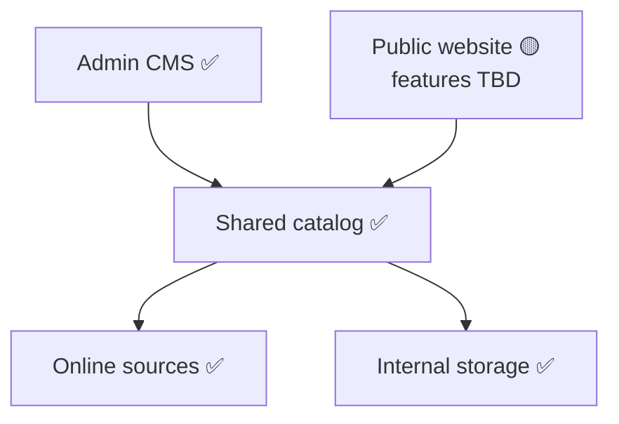

# Collaborative Loop (Guided Mode)

Work like a senior product manager pairing with the user: **propose, visualize, draft, ask for one decision, update** — and repeat until the requirements are agreed. The user should always see a concrete, versioned proposal they can react to, never a wall of questions and never a "final" document built on guesses.

## The loop

```text
Propose → Visualize → Draft vN → Decide one thing → Update to vN+1 → …
```

Every guided turn uses this shape (skip a part only when it adds nothing):

1. **Understanding + key insight.** Two to four sentences restating what you understood, then one **bold, opinionated insight** — the most important thing you would do differently or watch out for. Lead with a point of view, not a question.
2. **Diagram.** One small diagram that shows the current shape of the idea (see *Diagrams*). On later turns, update the same diagram and mark what is now decided.
3. **Structure table (when useful).** Capabilities, user types, or scope grouped in a table with a one-line role for each row. Call out one subtle distinction the user is likely to miss.
4. **Draft vN.** Create or update the PRD file and say what changed (see *Versioned drafts*).
5. **Next steps (optional).** A short phased roadmap when the idea is larger than one release — each phase with a one-line reason for its position.
6. **One blocking decision.** End with the single decision that most blocks progress (see *Asking for a decision*). If two are truly independent and both blocking, ask at most three.

When the user answers — even loosely, mixing several topics — start the next turn with "Updated based on your decisions:", fold **every** stated decision into the diagram and draft, then raise the next most important issue.

**Keep the loop moving until v1.0.** Every turn ends with a decision for the user to answer — never with only a list of remaining questions, a "reply 'yes' if correct" sentence, or a summary.

- **Progress line.** After the draft update, show one line against the agenda (see *Decision agenda and when to stop*), such as `Agenda: 4/9 decided · next: <topic> · then: <topic>, <topic>`, so the user sees how far v1.0 is.
- **Confirming a typed answer.** When you had to interpret a typed answer, do not ask for confirmation in prose. Put the confirmation in the same choice form as the next decision: one question "I understood <X> — correct?" with options *Correct (recommended)* / *<the most likely alternative>*, plus the next blocking decision as a second question.
- **Open questions are the queue.** Each `Q-n` in the draft's open-questions list is asked in a later turn, highest impact first, until every question that changes scope, requirements, or metrics is ✅ or explicitly deferred by the user. Questions that change nothing are moved to *Open questions (non-blocking)* instead of being asked.
- **Closing.** When the blocking queue is empty, ask a final choice: *Finalize v1.0 (recommended)* / *Review section by section first*. Do not stop at a v0.x draft without offering this.

## Starting point

- **Rich input** (notes, existing docs, tickets, a codebase): propose directly and create Draft v0.1 in the first turn, marking every proposal that is not backed by the input as 🟡 proposed.
- **Thin input** (one-line idea): do not write a PRD yet. Turn 1 proposes 2–3 product directions (target user × core value × MVP shape) with a diagram for the recommended one, and asks which direction to pursue. Draft v0.1 starts once a direction is chosen.
- **Fast mode requested** ("just write it"): skip the loop, draft the full document, and list every unconfirmed item as an assumption.

## Which decision to ask next

Ask the decision whose answer would change the most downstream content. Typical order for a PRD, adjusted to what is already known:

1. Problem and target user (who exactly, which situation)
2. Product direction / value proposition vs. alternatives
3. MVP scope — what is Must vs. later (MoSCoW)
4. Primary user journey for the Must scope
5. Success metric and target
6. Constraints and rollout (deadline, platforms, compliance)

Challenge weak inputs while doing this: a vague problem, an oversized MVP, or an unmeasurable goal deserves a sharper counter-proposal. If the idea does not survive scrutiny (no real problem or user), say so plainly and suggest what to validate first.

## Decision agenda and when to stop

The loop must have a visible end. Plan it, keep it short, and close it.

**0. Stages with approval gates.** Build the document in stages — Context & goals → Users & journeys → Domain model & business rules → Functional requirements & acceptance criteria → Metrics, scope & release — and show them as a checklist with status (✅ approved · 🔄 in progress · ⏳ not started). A stage closes only when the user approves it; ask for that approval through the choice tool (*Approve <stage> (recommended)* / *Needs changes*), bundled with the first decision of the next stage. Approved stages are not reopened unless the user asks or a later answer changes them (then use *Answers to an already-decided question*).

**Documentation sets.** If the user asks for a whole set of documents ("build the docs for my app"), first show a short document map — each document, what it covers, which skill produces it, and the order (product requirements first, then architecture) — and confirm it before starting the first one. Do not draft documents another skill owns.

**1. Publish the agenda first.** On the first guided turn, list the decisions that must be made before v1.0 — usually **6–10** — as a numbered checklist (`D-1 … D-n`, one line each, recommended answer in brackets when you already have one). This is the scope of the conversation. Show it again, with ✅ / 🟡 / ⏳ marks, whenever it changes.

**2. Ask only one-way-door decisions.** A question earns a place on the agenda only if the answer is hard to reverse later or changes the structure of the document, for example: target user, product direction, MVP scope (Must vs. later), primary journey, primary success metric, a hard constraint such as platform or compliance.

**3. Decide the rest yourself as defaults.** Two-way-door and implementation-level details — for example default categories, list sort order, copy and labels, notification wording, minor validation rules, exact non-primary metrics — are not asked one by one. Choose a sensible default, record it as 🟡 in a *Defaults (review anytime)* table in the draft (item, default, one-line reason), and mention new defaults in one line per turn. The user can override any default by replying; that does not reopen the loop.

**4. Batch to move faster.** Ask up to 3 independent agenda items in one choice-tool call. Never ask the same topic twice unless the user reopens it.

**5. New agenda items need a reason.** Add a decision to the agenda only when an answer or a user idea creates a new one-way door; say why it was added and show the new total (`Agenda: 6/9 decided · +1 added: <topic> because <reason>`).

**6. Stop rules.**
- Close the loop when every agenda item is ✅ or explicitly deferred, and problem, target user, MVP scope, primary journey, primary metric, and hard constraints are confirmed. Remaining unknowns that do not block implementation go to *Open questions (non-blocking)*.
- If the asked decisions reach about **10** and items remain, stop adding: offer *Finalize v1.0 with the remaining items as 🟡 defaults (recommended)* / *Continue with the remaining <n> decisions* / *Review the defaults table first*.

**7. Keep the conversation light.** The draft file is the memory, not the chat: show only what changed, the progress line, and the diagram when it changed. If the conversation is getting long, suggest continuing in a new chat that starts from the latest draft file and its decision log, so nothing is lost.

## Asking for a decision

Every decision is asked through the host's **choice tool** when one is available — on **every** turn of the loop, not only the first. Plain-text A/B/C lists are only the fallback for hosts without such a tool. After calling the tool, **end your turn and wait**: do not continue drafting content that depends on the answer.

### Host choice tools

| Host | Tool | How to fill it |
|---|---|---|
| ChatGPT, Codex | `request_user_input_async` | `questions: [{"title": "<full question with the context needed>", "options": ["<recommended> (recommended)", "<option>", "<option>"]}]` — options are plain strings |
| Codex Plan mode | `request_user_input` | 1–3 questions, each `{"id": "snake_case", "header": "≤12 chars", "options": [{"label": "1–5 words (Recommended)", "description": "one-sentence trade-off"}, …]}` with 2–3 options |
| Claude (Claude Code, Desktop, claude.ai) | `AskUserQuestion` or the host's equivalent | 1–4 questions, each with a short `header`, 2–4 options with `label` + `description`, and `multiSelect` (true when several answers are allowed); add "(Recommended)" to the first option's label |
| Any other host with a choice form | that tool | same rules below |

Rules for every choice tool:

- **Give every decision a stable ID** (`D-1`, `D-2`, …) and put it at the start of the question title (for example "D-3 · Primary user: …"). Use the same ID in the draft's decision log, so any answer can be traced to its question.
- **Recommended option first**, with "(recommended)" in its label in the user's language. Several hosts preselect the first option.
- **Do not add an "Other" option or a free-text placeholder.** These tools add free-text input automatically.
- **Short labels, consequences in descriptions** (or after a dash when options are plain strings). 2–4 mutually exclusive options in the user's domain terms.
- **The title is self-contained**: the user may see only the form, so include the context needed to answer.
- **Up to 3 questions in one call** when they are independent (for example, confirming an interpreted answer plus the next decision). Otherwise one.
- **Multiple-choice questions** (the user may pick several, for example which features go into the MVP, which platforms, which user roles):
  - Claude `AskUserQuestion`: set `multiSelect: true`.
  - Any other tool with a multi-select flag: use it.
  - ChatGPT / Codex (single-select plus free text): say in the title that several can be chosen and how to type them (for example "Choose one set, or type your own combination such as \"A, C, D\""). Offer ready-made sets as options, recommended set first — for example "Core set (recommended): A + B + D", "All of them", "Only A". Do not split one multi-select question into many yes/no questions.
  - Plain-text fallback: label the items A, B, C… and end with "Reply with one or more letters (for example \"A, C\"), your own answer, or \"you decide\"".
  - Record every selected item as its own decision in the draft (for example each chosen feature as Must), and the unselected ones as Later / out of scope.
- **Never put instructions in options or titles** such as "update the PRD and ask the next question". The selection the user submits should read as their answer only.

### Fallback: plain text

Only when the host has no choice tool:

```text
### Decision needed before <next step>

<Question?>

A) <Option> — <what it means / consequence> ← recommended: <one-line reason>
B) <Option> — <what it means / consequence>
C) <Option> — <what it means / consequence>

Reply with a letter, your own answer, or "you decide".
```

### Handling answers

- Options are concrete and mutually exclusive; the consequence of each is visible so the user decides on trade-offs, not labels.
- "You decide" → take the recommendation and record it as 🟡 assumption, not ✅ confirmed.
- A typed answer takes priority over a selected option. If it is unclear or contradicts the options, record your interpretation as 🟡 and confirm it through the choice tool on the next turn (see *Keep the loop moving until v1.0*); mark it ✅ only after the user agrees.
- **Answers to an already-decided question.** Hosts keep old forms clickable, so the user may scroll up and pick a different option for an earlier `D-n`. Never overwrite silently:
  1. Say which decision it changes ("This changes D-2 · Primary user from *Individual gamers* to *Collectors*").
  2. List what depends on it: later decisions, requirements, metrics, and diagram nodes that would change or become invalid.
  3. Ask through the choice tool: *Keep <current value> (recommended unless the user clearly meant to change it)* / *Change to <new value> and update the affected parts*.
  4. On *Change*: bump the draft version, update every affected part, mark dependent decisions 🟡 for re-confirmation, and record the old and new value in the change log. On *Keep*: change nothing and continue with the pending question.
  - If a pending question is still open, answer handling for it comes first; then raise the change.

### New ideas and side discussions

The user may bring up something outside the pending question — a feature they just remembered, a constraint, a change of mind — and discuss it freely in chat. Never let it stay only in the conversation:

1. Discuss it as long as the user wants; give your opinion and any trade-off they should know.
2. When the discussion reaches a conclusion (or the user moves on), end the turn with a **short summary** of what was agreed — what it is, who it is for, and why — then ask through the choice tool how to capture it. Give it a new ID (`D-n`, or `FR-n` for a requirement) and options such as:
   - *Add to the draft as <Must / MVP> (recommended when it serves the primary journey)*
   - *Add as <Should / Later phase>*
   - *Record as an open question to decide later*
   - *Don't add it*
3. On an *Add* answer: update the draft, diagram, and scope table, bump the version, and log it in the change log. If it conflicts with or changes an earlier decision, handle it like *Answers to an already-decided question* (show impact, ask keep or change).
4. If a decision was pending before the side discussion, ask it again in the **same** choice tool call as the capture question, so the loop continues.

## Diagrams

Use Mermaid in fenced code blocks; it renders in most agent UIs, IDEs, and on GitHub. If rendering is unavailable, an indented text diagram is acceptable. Keep each diagram to roughly 12 nodes or fewer — one idea per diagram.

Pick by purpose:

| Purpose | Diagram |
|---|---|
| Who interacts with the product and what surrounds it | `flowchart` context diagram: users → product → external systems |
| Main user journey | `flowchart LR` of steps, or `journey` |
| Scope and phasing | `flowchart` grouping Must / Should / Later, or a table |
| States of a key object (order, request, subscription) | `stateDiagram-v2` |

Mark decision status on nodes so the diagram doubles as a decision map:



- ✅ confirmed by the user · 🟡 proposed or assumed · `TBD` unknown — never fill an unknown with an invented detail.
- When a diagram becomes fully confirmed, title it "Agreed …" so the user sees progress.

## Versioned drafts

- Save to the PRD file from the start (default `docs/requirements/<feature-name>.md`; inline if there is no project). Update the same file each turn — do not create a new file per version.
- Bump the version in the header on every substantive update: v0.1, v0.2, … Reserve v1.0 for the version the user approves.
- Keep a **Change log** at the end of the document: version → decisions applied → sections changed.
- Mark content inline: unconfirmed proposals carry 🟡, unknowns say `TBD`. The *Decisions, assumptions, and open questions* section is the decision log.
- Keep v0.x drafts compact: labeled bullets (**Pain:** / **Who:** / **Why now:** / **Assumptions:**) rather than prose, and omit sections with nothing decided yet instead of filling them with TBD. Expand to full prose and tables on the way to v1.0.
- In chat, show only what changed and the diagram — not the whole document.

## Clarification notes

When a term or boundary could be misread, add a short **Note:** after the table or diagram that pins down the meaning (for example, which users count as "admin", or whether an external service counts as part of the product). These notes prevent most rework.

## Finishing

Move to the outline/quality pass when the essentials are ✅: problem, target user, MVP scope, primary journey, primary metric, and hard constraints. Then complete acceptance criteria, run the quality checklist, ask the user to approve v1.0, and offer the handoff to `architecture-requirements`.
