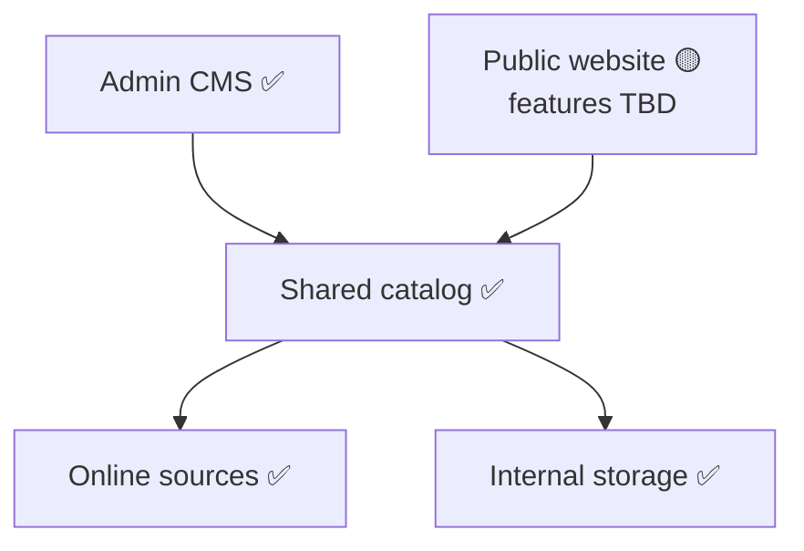

# Collaborative Loop (Guided Mode)

Work like a senior product manager pairing with the user: **propose, visualize, draft, ask for one decision, update** — and repeat until the requirements are agreed. The user should always see a concrete, versioned proposal they can react to, never a wall of questions and never a "final" document built on guesses.

## The loop

```text
Propose → Visualize → Draft vN → Decide one thing → Update to vN+1 → …
```

Every guided turn uses this shape (skip a part only when it adds nothing):

1. **Understanding + key insight.** Two to four sentences restating what you understood, then one **bold, opinionated insight** — the most important thing you would do differently or watch out for. Lead with a point of view, not a question.
2. **Diagram.** One small diagram that shows the current shape of the idea (see *Diagrams*). On later turns, update the same diagram and mark what is now decided.
3. **Structure table (when useful).** Capabilities, user types, or scope grouped in a table with a one-line role for each row. Call out one subtle distinction the user is likely to miss.
4. **Draft vN.** Create or update the PRD file and say what changed (see *Versioned drafts*).
5. **Next steps (optional).** A short phased roadmap when the idea is larger than one release — each phase with a one-line reason for its position.
6. **One blocking decision.** End with the single decision that most blocks progress (see *Asking for a decision*). If two are truly independent and both blocking, ask at most three.

When the user answers — even loosely, mixing several topics — start the next turn with "Updated based on your decisions:", fold **every** stated decision into the diagram and draft, then raise the next most important issue.

## Starting point

- **Rich input** (notes, existing docs, tickets, a codebase): propose directly and create Draft v0.1 in the first turn, marking every proposal that is not backed by the input as 🟡 proposed.
- **Thin input** (one-line idea): do not write a PRD yet. Turn 1 proposes 2–3 product directions (target user × core value × MVP shape) with a diagram for the recommended one, and asks which direction to pursue. Draft v0.1 starts once a direction is chosen.
- **Fast mode requested** ("just write it"): skip the loop, draft the full document, and list every unconfirmed item as an assumption.

## Which decision to ask next

Ask the decision whose answer would change the most downstream content. Typical order for a PRD, adjusted to what is already known:

1. Problem and target user (who exactly, which situation)
2. Product direction / value proposition vs. alternatives
3. MVP scope — what is Must vs. later (MoSCoW)
4. Primary user journey for the Must scope
5. Success metric and target
6. Constraints and rollout (deadline, platforms, compliance)

Challenge weak inputs while doing this: a vague problem, an oversized MVP, or an unmeasurable goal deserves a sharper counter-proposal. If the idea does not survive scrutiny (no real problem or user), say so plainly and suggest what to validate first.

## Asking for a decision

If the platform offers a structured question or choice tool (a selectable form), use it for **every** decision, on **every** turn of the loop — not only the first one. Never fall back to plain-text A/B/C options while the tool is available, even after the user has answered previous questions in chat or by typing. Always include a free-text "Other" option (see below). If the platform has no such tool, use this format:

```text
### Decision needed before <next step>

<Question?>

A) <Option> — <what it means / consequence>
B) <Option> — <what it means / consequence>
C) <Option> — <what it means / consequence> ← recommended: <one-line reason>

Reply with a letter, your own answer, or "you decide".
```

- Options are concrete and mutually exclusive, written in the user's domain terms.
- The consequence of each option is visible, so the user decides on trade-offs, not labels.
- "You decide" → take the recommendation and record it as 🟡 assumption, not ✅ confirmed.

**Always let the user type their own answer.** Every question must accept a free-text answer in addition to the listed options:

- **Choice tool / form** (radio buttons, option chips): add a last option **"Other — type your own answer"** with a text input. If the tool cannot attach a text field to an option, add a separate optional free-text field ("Your own answer") under the options, or state right below the form that the user can type any answer in chat instead.
- **Plain text:** keep the closing line "Reply with a letter, your own answer, or \"you decide\"".
- Mark the recommended option in the form label too (for example "B. Several properties (recommended)"), not only in the text above it.
- A typed answer takes priority over a selected option. If it is unclear or contradicts the options, restate how you understood it and record it as ✅ confirmed only after the user agrees.

## Diagrams

Use Mermaid in fenced code blocks; it renders in most agent UIs, IDEs, and on GitHub. If rendering is unavailable, an indented text diagram is acceptable. Keep each diagram to roughly 12 nodes or fewer — one idea per diagram.

Pick by purpose:

| Purpose | Diagram |
|---|---|
| Who interacts with the product and what surrounds it | `flowchart` context diagram: users → product → external systems |
| Main user journey | `flowchart LR` of steps, or `journey` |
| Scope and phasing | `flowchart` grouping Must / Should / Later, or a table |
| States of a key object (order, request, subscription) | `stateDiagram-v2` |

Mark decision status on nodes so the diagram doubles as a decision map:



- ✅ confirmed by the user · 🟡 proposed or assumed · `TBD` unknown — never fill an unknown with an invented detail.
- When a diagram becomes fully confirmed, title it "Agreed …" so the user sees progress.

## Versioned drafts

- Save to the PRD file from the start (default `docs/requirements/<feature-name>.md`; inline if there is no project). Update the same file each turn — do not create a new file per version.
- Bump the version in the header on every substantive update: v0.1, v0.2, … Reserve v1.0 for the version the user approves.
- Keep a **Change log** at the end of the document: version → decisions applied → sections changed.
- Mark content inline: unconfirmed proposals carry 🟡, unknowns say `TBD`. The *Decisions, assumptions, and open questions* section is the decision log.
- Keep v0.x drafts compact: labeled bullets (**Pain:** / **Who:** / **Why now:** / **Assumptions:**) rather than prose, and omit sections with nothing decided yet instead of filling them with TBD. Expand to full prose and tables on the way to v1.0.
- In chat, show only what changed and the diagram — not the whole document.

## Clarification notes

When a term or boundary could be misread, add a short **Note:** after the table or diagram that pins down the meaning (for example, which users count as "admin", or whether an external service counts as part of the product). These notes prevent most rework.

## Finishing

Move to the outline/quality pass when the essentials are ✅: problem, target user, MVP scope, primary journey, primary metric, and hard constraints. Then complete acceptance criteria, run the quality checklist, ask the user to approve v1.0, and offer the handoff to `architecture-requirements`.
