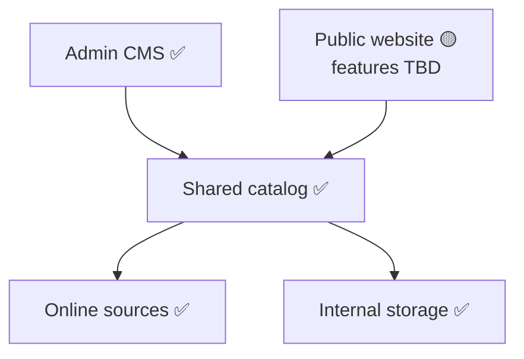

# Diagrams

Write diagrams as Mermaid in fenced code blocks tagged `mermaid`. That is the portable source kept in the document file; GitHub, IDEs, Claude, and most Markdown viewers render it. Keep each diagram to about 12 nodes; split rather than cram.

## Pick by purpose

| Purpose | Diagram |
|---|---|
| Who interacts with the product and what surrounds it | `flowchart` context diagram: users → product → external systems |
| Main user journey | `flowchart LR` of steps, or `journey` |
| Scope and phasing | `flowchart` grouping Must / Should / Later, or a table |
| States of a key object (order, request, subscription) | `stateDiagram-v2` |
| Business objects and relationships | `erDiagram`, conceptual only: no attributes or types |

## Mark decision status

Mark nodes so the diagram doubles as a decision map:

- ✅ confirmed by the user · 🟡 proposed or assumed · `TBD` unknown. Never fill an unknown with an invented detail.
- When a diagram is fully confirmed, title it "Agreed …" so the user sees progress.

## Write Mermaid that renders

- One relationship per line.
- Entity names in `UPPER_SNAKE` or `PascalCase`, without spaces.
- Labels with spaces in quotes: `CUSTOMER ||--o{ ORDER : "places"`.
- Node text with emoji or punctuation in quotes: `A["Admin CMS ✅"]`.

## Make sure the user sees a diagram, not code

Some surfaces show Mermaid as plain text, notably ChatGPT's chat, canvas, and document views. There:

1. Keep the `mermaid` block in the saved document unchanged.
2. In the chat, also render the diagram visually with the host's own tool (inline visualization, image, or diagram tool).
3. With no visual tool, show a readable fallback instead of raw Mermaid: for an ER diagram, a relationship table (`Object | Relationship | Object | Cardinality`, such as `Branch | manages | Vehicle | 1 : N`); for flows, a numbered list or an indented text tree.
4. Never leave unrendered Mermaid as the only view in chat. If the user says a diagram "is broken" or shows as code, use steps 2–3 for the rest of the conversation.
