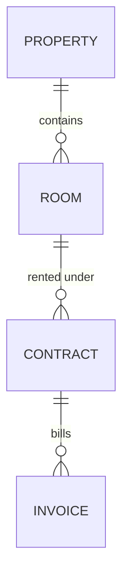

# Product Requirements Template

Copy this structure. Omit sections that do not apply; do not reorder. Replace every `<placeholder>`.

---

````markdown
# <Product or Feature Name> — Product Requirements

| Field | Value |
|---|---|
| Status | Draft / In review / Approved |
| Version | <v0.1 while iterating; v1.0 when approved> |
| Owner | <name or role> |
| Last updated | <YYYY-MM-DD> |
| Related | <links to research, designs, tickets, architecture doc> |

## 1. Summary

<Two to four sentences: what is being built, for whom, and why now.>

## 2. Problem

- **Problem statement:** <The user or business problem, in the user's terms.>
- **Evidence:** <Data, research, support tickets, or quotes that show the problem is real. Mark as assumption if none.>
- **Impact of not solving:** <Cost of inaction.>
- **Why now:** <What changed — market, technology, regulation, customer demand — that makes this the right time.>

## 3. Goals and non-goals

### Goals
- G-1: <Outcome, not output.>

### Non-goals
- <Explicitly out of scope, to prevent scope creep.>

## 4. Target users

| Persona / segment | Description | Primary need |
|---|---|---|
| <name> | <who they are> | <what they need from this> |

- **Job to be done:** "When <situation>, I want to <motivation>, so I can <expected outcome>."
- **Not serving in this release:** <segments deliberately excluded, and why>

## 5. User journeys

### J-1: <Journey name>
1. <Trigger / starting point>
2. <Step>
3. <Outcome the user achieves>

**Edge cases**
- E-1: <unusual or failure situation, e.g. missing data, conflicting input, permission denied> → covered by AC-<n.n>

## 6. Domain model and business rules

Conceptual level only: business objects in the user's language, how they relate, and the rules that govern them. No column types, keys, indexes, or storage — those belong to the architecture document.

| Object | Meaning | Key business facts | Lifecycle |
|---|---|---|---|
| <Room> | <a rentable unit inside a property> | <code, rent, capacity> | <vacant → reserved → occupied → maintenance> |



**Relationship notes:** <cardinality the diagram cannot show, e.g. "a room has at most one active contract at a time">

**Business rules**

| ID | Rule | Worked example |
|---|---|---|
| BR-1 | <calculation, constraint, or policy stated precisely> | <numbers in → result out, e.g. "rent 3,000,000/month, move-in on day 16 of a 30-day month → 1,500,000"> |

Give every calculation or money rule a worked example, and state rounding, boundaries (start/end day included?), and what happens on change mid-period.

## 7. Functional requirements

| ID | Requirement | Priority | Journey |
|---|---|---|---|
| FR-1 | The system shall <behavior>. | Must / Should / Could | J-1 |

Priority uses MoSCoW: **Must** (release blocker), **Should** (important, not blocking), **Could** (nice to have), **Won't** (explicitly deferred).

## 8. Acceptance criteria

### FR-1: <short name>
- AC-1.1: Given <context>, when <action>, then <observable result>.
- AC-1.2: ...

## 9. Non-functional requirements (product-level)

Only the expectations the business cares about; the architecture phase refines them.

| ID | Category | Requirement |
|---|---|---|
| NFR-1 | Performance / Availability / Accessibility / Privacy / Localization / Compliance | <measurable expectation> |

## 10. Success metrics

| ID | Metric | Baseline | Target | Measurement |
|---|---|---|---|---|
| M-1 | <metric> | <current value or "unknown"> | <target and timeframe> | <data source / method> |

Include at least one leading indicator (adoption, activation) and one lagging indicator (retention, revenue, cost), plus guardrail metrics that must not get worse.

**Instrumentation**
- **Events:** `<object_action>` (e.g. `project_created`, `report_exported`) — the events needed to compute each metric
- **Funnel:** <step → step → step>
- **Alerts:** <threshold that signals a problem, or "TBD — owner">

## 11. Scope and release plan

- **In scope (v1):** <list>
- **Later / out of scope:** <list>
- **Rollout:** <phases, feature flags, beta cohort, regions>
- **Experiment:** <the hypothesis the release tests and how it will be judged, if any>
- **Kill switch / rollback:** <how the feature can be disabled or reverted if it misbehaves>
- **Dependencies:** <teams, systems, vendors, legal>

## 12. Risks

| Risk | Likelihood | Impact | Mitigation |
|---|---|---|---|
| <risk> | Low / Med / High | Low / Med / High | <mitigation> |

## 13. Decisions, assumptions, and open questions

### Confirmed decisions
- D-1: <decision> — <who / when>

### Assumptions
- A-1: <assumption> — <how to validate>

### Open questions
- Q-1: <question> — <owner, needed by>

## 14. Appendix

<Glossary, research notes, mockup links.>

## Change log

| Version | Decisions applied | Sections changed |
|---|---|---|
| v0.1 | <initial proposal> | All |
````
