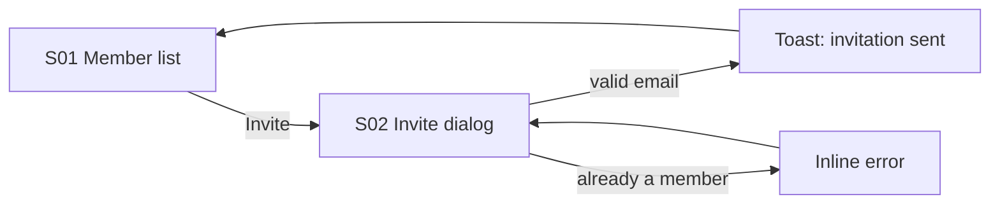

# UX Planning

Plan before you build: which screens exist, how people move between them, and what each screen shows in every state. Keep the plan short and visual; it is a working tool, not a deliverable on its own.

## 1. Inputs

Read what exists, in this order:

| Source | Take from it |
|---|---|
| Feature spec (`docs/03-functional-specs/F<nn>-*.md`) | Journeys (`J-x`), functional requirements (`FR-x`), acceptance criteria, edge cases |
| `docs/01-business/01-actors-and-permissions.md` | Who sees which screen and action |
| `docs/01-business/02-domain-model.md` | Objects, fields, and lifecycles (statuses) to display |
| `docs/01-business/03-business-rules.md` | Validation and conditional UI |
| `docs/00-overview/02-glossary.md` | The words to use in the UI |
| The request or existing UI | Everything else |

Missing information becomes an assumption you state, or a question if it blocks the layout.

## 2. Screen map

List every screen the feature needs. A screen is a page, dialog, sheet, or drawer with its own purpose. Start from the typical pages of the surface in `surfaces.md`, then keep only what the requirements need.

| ID | Screen | Type | Purpose | Actors | Covers |
|---|---|---|---|---|---|
| S01 | Member list | Page | Find and manage members | Admin | F04/J-1, F04/FR-1 |
| S02 | Invite member | Dialog | Invite by email | Admin | F04/FR-2 |

Rules:

- Prefer **fewer screens**. Use a dialog or sheet for short tasks that return to the same context; use a page for tasks with their own URL, long forms, or deep detail.
- Every journey step lands on a screen, and every screen serves at least one journey.
- Number screens `S01`, `S02`… and keep the numbers stable.

## 3. Flows

Draw one flow per journey, including the main error path:



Check each flow for: the shortest path to the goal, a way back or out at every step, and confirmation before destructive or irreversible actions.

## 4. States per screen

For each screen, decide what the user sees in each state:

| State | Decide |
|---|---|
| Loading | Skeleton matching the layout (not a full-page spinner); on landing pages and storefront product pages, content is server-rendered so it rarely needs one |
| Empty (first use) | Explanation and the primary action |
| Empty (no results) | Which filters caused it and how to clear them |
| Error | What failed, in plain words, and a retry |
| Partial | What is shown when some data is missing |
| Success | Feedback after an action (toast, inline message, redirect) |
| Disabled / read-only | Why the action is unavailable |
| No permission | What a user without access sees (hidden, disabled with reason, or a message) |

## 5. Screen outline

Before coding a complex screen, write a short outline:

```text
S01 Member list (Page, Admin)
  Header: title, member count, primary action "Invite"
  Toolbar: search, role filter, status filter
  Body: table (name, email, role, status badge, last active, row menu)
  Row menu: change role, resend invite, remove (confirm)
  Footer: pagination
  States: skeleton rows · empty with Invite · no results with Clear filters · error with Retry
```

## 6. Saving the plan

- Show the screen map, flows, and outlines in the conversation.
- When the project uses the standard `docs/` structure, save them to `docs/04-ui/` (for example `docs/04-ui/01-screen-map.md` and one section per flow), and reference requirement IDs instead of repeating requirements.
- Record design decisions in `docs/09-working/decisions-log.md` and open questions in `docs/09-working/open-questions.md` when those files exist.
